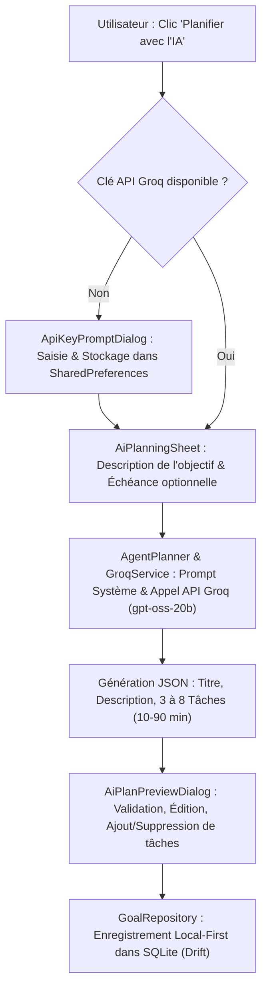

# Focus60

Application de Deep Work et de productivité basée sur des cycles d'attention dégressifs (50 → 10 minutes) pour optimiser la concentration et éliminer les distractions.

---

## Le Concept (50 → 10)

Une session de travail complète s'organise en 5 blocs dégressifs intercalés de pauses de récupération :

- **Bloc 1** : 50 min *(Focus maximal)* + 10 min de pause
- **Bloc 2** : 40 min *(Focus soutenu)* + 10 min de pause
- **Bloc 3** : 30 min *(Rythme de croisière)* + 10 min de pause
- **Bloc 4** : 20 min *(Accélération)* + 10 min de pause
- **Bloc 5** : 10 min *(Sprint final)*

---

## Fonctionnalités Principales

- **Minuteur Séquentiel** : Compte à rebours circulaire avec distinction visuelle Travail / Pause et indicateur de progression en escalier.
- **Planification & Assistant IA** : Décomposition automatique d'objectifs globaux en sous-tâches concrètes et estimées en temps via l'API Groq (JSON structuré), avec prévisualisation et édition avant sauvegarde.
- **Gestion des Objectifs & Tâches** : Organisation par objectif, sous-tâches avec durées estimées et association directe au minuteur de focus.
- **Anti-Distraction & Isolation Native** : Contrôles d'isolation basés sur du code Kotlin natif via MethodChannels pour la gestion du mode Ne Pas Déranger (NotificationManager) et du verrouillage d'écran (LockTask).
- **Statistiques & Tableau de Bord** : Suivi du temps de concentration hebdomadaire, histogramme journalier et séries de régularité (*streaks*).
- **Architecture Local-First** : Stockage local SQLite réactif et découplé via Riverpod et le Repository Pattern.

---

## Agent IA

Focus60 intègre un assistant IA propulsé par l'API **Groq** (`openai/gpt-oss-20b`) capable de décomposer automatiquement un objectif global en un plan de tâches concrètes et estimées en temps.

### Workflow de l'Agent



### Configuration

Obtenez une clé API gratuite sur [console.groq.com](https://console.groq.com/keys).

- **Via le fichier .env** :
  
- **Via l'interface application** : La clé sera demandée automatiquement lors de la première utilisation de l'assistant si elle n'est pas encore définie.

---

## Stack Technique

- **Framework UI** : [Flutter](https://flutter.dev/) (Dart)
- **Intégration Native Android** : [Kotlin](https://kotlinlang.org/) (MethodChannels pour le contrôle de NotificationManager DND et LockTask)
- **State Management & DI** : [Riverpod](https://riverpod.dev/)
- **Base de Données** : [Drift](https://drift.simonbinder.eu/) (SQLite)
- **Services IA** : API Groq (`openai/gpt-oss-20b`) pour la génération structurée de plans
- **CI/CD & DevSecOps** : GitHub Actions (Analyse statique de code, tests automatisés, audit de sécurité)

---

## Démarrage Rapide

```bash
# Télécharger les dépendances
flutter pub get

# Générer les fichiers de code (Drift)
dart run build_runner build --delete-conflicting-outputs

# Lancer les tests
flutter test

# Démarrer l'application
flutter run
```
